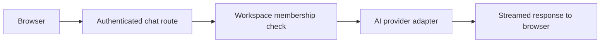
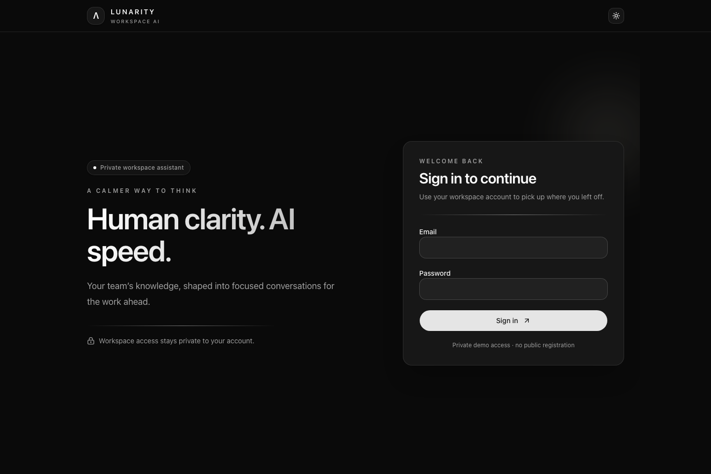
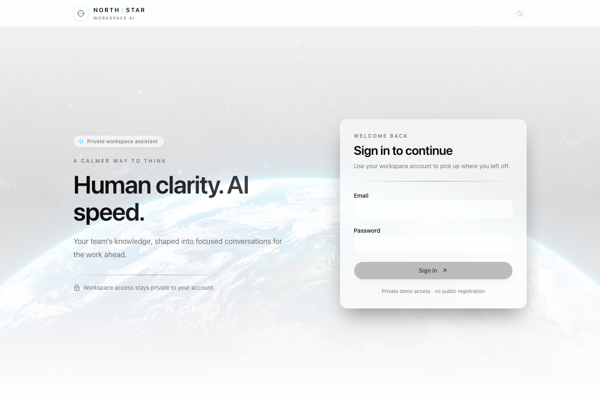
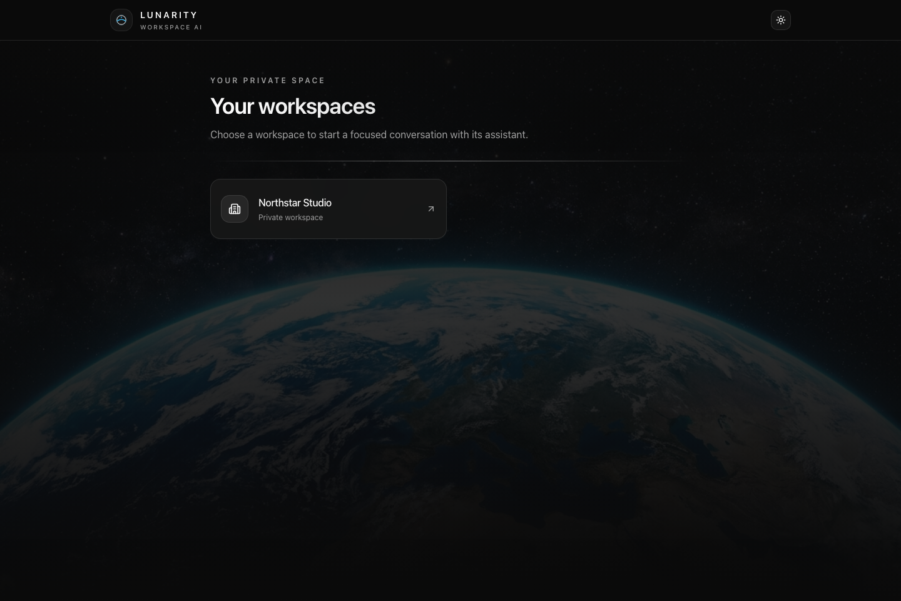
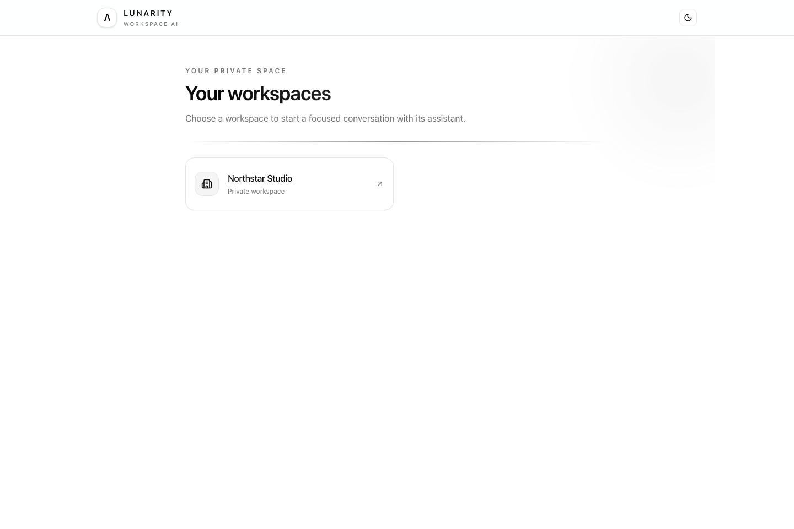
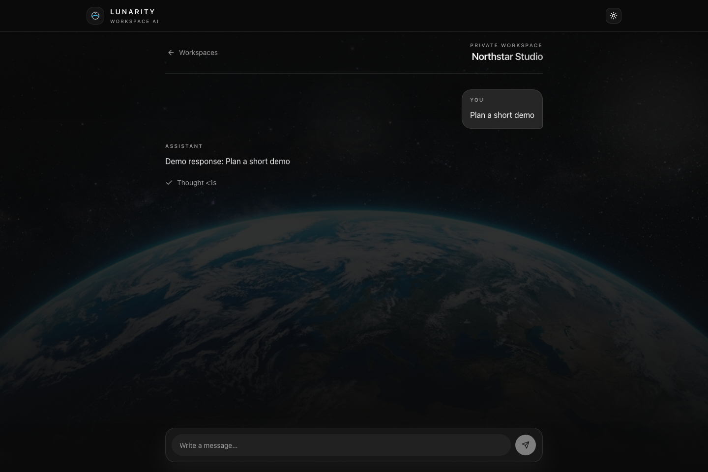
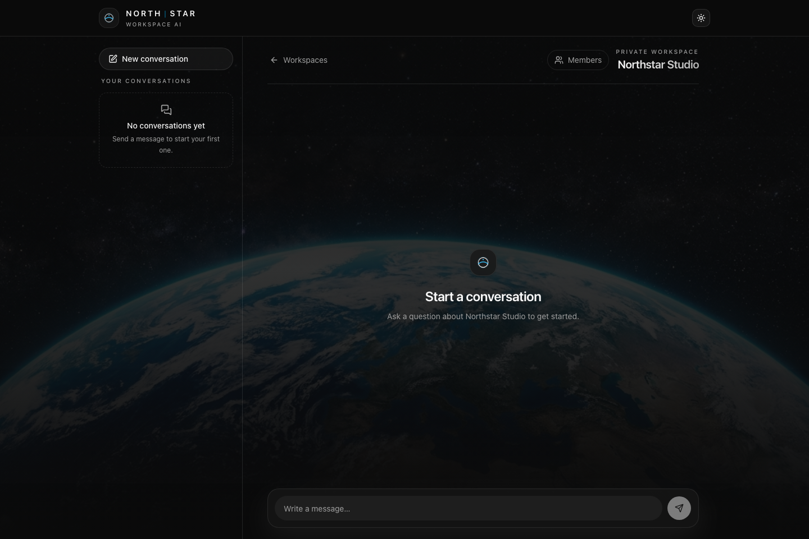

# Workspace AI Assistant

A self-hosted starter for a multi-tenant AI chat application: authenticated, workspace-isolated chat with streamed output. You fork it, set environment variables and run one instance (see `docs/adr/0005-self-hosted-starter.md` and `docs/product.md`). Each Conversation is stored in PostgreSQL, private to the User who had it in that Workspace, so a reload keeps it.

## Local setup

Requirements: Node.js 20+, PostgreSQL listening on localhost port 5433 (the port in `.env.example`), and a local database named `workspace_ai`.

1. Copy `.env.example` to `.env`. If you already have a `.env`, add `APP_ENV=development` to it and point `DATABASE_URL` at port 5433.
2. Keep `APP_ENV=development` (one of `development`, `test` or `production`; see `docs/adr/0002-explicit-app-env.md`). `db:seed` refuses to run unless it is `development` or `test`, and `db:migrate` does the same except for the Deployer exception below; with `development` both require a localhost `DATABASE_URL`. Set `DATABASE_URL`, a random `BETTER_AUTH_SECRET` with at least 32 characters, and distinct synthetic passwords for `DEMO_USER_A_PASSWORD` and `DEMO_USER_B_PASSWORD`. The example supplies demo email addresses.
3. Install dependencies and prepare the database:

   ```sh
   npm ci
   createdb -h localhost -p 5433 workspace_ai
   npm run db:migrate
   npm run db:seed
   ```

4. Configure the AI provider in `.env.local` (see `.env.example`). There are no defaults, and a missing or invalid value is an error that names the variable:
   - `AI_PROVIDER=openai` needs `AI_MODEL` (for example `gpt-4o-mini`) and `AI_API_KEY`.
   - `AI_PROVIDER=openai-compatible` needs `AI_BASE_URL` (for example `http://localhost:1234/v1`) and `AI_MODEL`; `AI_API_KEY` is optional and, when unset, no `Authorization` header is sent. It works with LM Studio, Ollama, OpenRouter, Groq and similar servers. See [Local model with LM Studio](#local-model-with-lm-studio).
   - `AI_PROVIDER=fake` is a deterministic demo stream, allowed only when `APP_ENV` is `development` or `test`. `AI_FAKE_DELAY_MS` (default `120`) sets its pause before each chunk.

   **One-time migration:** `OPENAI_API_KEY`, `CHAT_FAKE_PROVIDER` and `CHAT_FAKE_PROVIDER_DELAY_MS` are removed and have no effect. In your existing `.env.local`, replace them with `AI_PROVIDER`, `AI_MODEL`, `AI_API_KEY` (the old key's value) or `AI_PROVIDER=fake`, and `AI_FAKE_DELAY_MS`.

5. Start the app with `npm run dev` and open <http://localhost:3000>.

The repeatable seed creates User A/Northstar Studio and User B/Harbor Analytics with separate workspace instructions. Never use production credentials in local or automated testing.

**Deployer: migrating a non-local database.** With `APP_ENV=production`, `db:migrate` runs only when you confirm the database by name:

```bash
APP_ENV=production DATABASE_URL=... npm run db:migrate -- --confirm-database <name>
```

`<name>` must equal the database in `DATABASE_URL` and the name the live connection reports (`current_database()`). Otherwise the command refuses and changes nothing. A missing or unknown `APP_ENV` is refused with or without the flag, and the flag does not relax the development or test rules. `db:seed` never runs in production. See the note in `docs/adr/0002-explicit-app-env.md`.

**Deployer: first run (bootstrap).** On a Compose instance, follow the [Deployer walkthrough](#deployer-walkthrough-from-clone-to-first-conversation). Outside Compose, run `npm run bootstrap -- --workspace "Acme" [--confirm-database <name>]` on a migrated database; it uses the same database confirmation as `db:migrate` and prints the same single-use link.

Each message is limited to 4,000 characters, each conversation request to 30 messages, and each HTTP request body to 64 KB. Requests over these limits are rejected before provider invocation.

## Local model with LM Studio

Run the assistant against a model on your own machine. No API key or paid call is involved.

1. Install [LM Studio](https://lmstudio.ai) and its CLI, then download a model: `lms get google/gemma-3-12b` (pick a size that fits your RAM).
2. Start the server and load the model: `lms server start`, then `lms load google/gemma-3-12b`. The server listens on `http://localhost:1234/v1`. Check the exact id with `lms ls`.
3. Set the variables in `.env.local`:

   ```
   AI_PROVIDER=openai-compatible
   AI_BASE_URL=http://localhost:1234/v1
   AI_MODEL=google/gemma-3-12b
   ```

   Leave `AI_API_KEY` unset. Restart `npm run dev`.

### Trying another model (for example Bielik)

The model is chosen only by `AI_MODEL`, one per running app; there is no model picker in the UI. To try the Polish model [Bielik](https://huggingface.co/speakleash) next to Gemma, download a GGUF build in LM Studio (search "Bielik"; the 11B size in Q4 to Q8 fits in 24 GB), then:

1. Load it with a larger context, as below: `lms load <bielik-id> --context-length 16384`. Find `<bielik-id>` with `lms ls`.
2. Set `AI_MODEL=<bielik-id>` in `.env.local` and restart `npm run dev`.

To compare two models side by side, run two instances of the app on different ports, each with its own `AI_MODEL`.

### Context length for long Conversations

LM Studio loads a model with a **4096-token context** by default. A request can carry up to 30 messages of up to 4,000 characters each, plus the Assistant instructions, which is far more than 4096 tokens. With the default context, long Conversations may fail or lose their earlier turns, so load the model with a larger one:

```sh
lms unload google/gemma-3-12b   # if it is already loaded with the default context
lms load google/gemma-3-12b --context-length 16384
```

Confirm the loaded context in the `CONTEXT` column of `lms ps`; it should read `16384`, not `4096`.

A larger context uses more RAM (the model's KV cache grows with it). On a 24 GB Mac, `16384` is a sensible value for a 12B model such as `google/gemma-3-12b`; go higher only if you have memory to spare. 16384 covers typical Conversations but not a request at the maximum size above (roughly 30,000 tokens), so very long Conversations can still overflow it. To check before loading, add `--estimate-only` to `lms load`; the estimate is approximate.

### Manual smoke test

Not part of CI. With the dev server running and the model loaded:

- [ ] **Streaming:** send a message; the reply appears incrementally.
- [ ] **Stop:** press Stop mid-reply; text stops and the server ends generation (LM Studio's log shows it).
- [ ] **Retry:** run `lms server stop`, send a message and see the provider error; run `lms server start`, press Retry. The reply arrives with no duplicate user message.
- [ ] **Cancel on Workspace change:** start a reply, switch Workspace; generation is cancelled and messages, partial output and errors are cleared.

<!-- docker-compose:start -->
## Deployer walkthrough: from clone to first Conversation

Docker Compose (the app and PostgreSQL) is the one supported way for a Deployer to run an instance. This section is all you need; the other sections are for developing the starter itself. There is no public demo (ADR-0005): you run your own instance.

Requirements: Docker with Compose v2, and about 4 GiB of RAM available to Docker. Building the image (`next build`) is killed with 2 GiB (`SIGKILL` during "Running TypeScript"). On Colima run `colima stop && colima start --memory 4`; on Docker Desktop raise Memory in Settings → Resources.

1. **Clone** your fork and enter it.
2. **Configure.** Copy `.env.compose.example` to `.env` and fill it in. `.env` is git-ignored and never copied into the image.
   - `POSTGRES_PASSWORD`: URL-safe characters only, for example `openssl rand -hex 24`. `POSTGRES_USER` and `POSTGRES_DB` default to `workspace_ai`.
   - `BETTER_AUTH_SECRET`: at least 32 random characters, for example `openssl rand -hex 32`.
   - `BETTER_AUTH_URL`: the URL people open. It must match `APP_PORT` (default 3000) or your domain, or sign-in and Invitation links break.
   - `AI_PROVIDER` and `AI_MODEL`, plus `AI_API_KEY` (`openai`) or `AI_BASE_URL` (`openai-compatible`). The containers run with `APP_ENV=production`, so `AI_PROVIDER=fake` is refused. From inside a container `localhost` is the container: reach LM Studio on the host at `http://host.docker.internal:1234/v1`.
   - Compose stops with a message naming any of `POSTGRES_PASSWORD`, `BETTER_AUTH_SECRET`, `BETTER_AUTH_URL`, `AI_PROVIDER` or `AI_MODEL` that is missing.
3. **Start.** Run `docker compose up --build`. PostgreSQL starts and passes its healthcheck, then the one-shot `migrate` service applies `db/migrations`, then the app starts. If the migration fails, the app does not start. The seed never runs and there are no Demo users, so a fresh instance has no accounts.
4. **Create the first Workspace and Owner.** In a second terminal, in the same directory:

   ```sh
   docker compose run --rm migrate sh -c 'npm run bootstrap -- --workspace "Acme" --confirm-database "$POSTGRES_DB"'
   ```

   It prints "Created Workspace" and a single-use Owner Invitation link, once. Copy it now: only a hash of its token is stored. The link is valid for 7 days and built from `BETTER_AUTH_URL`.
5. **Join as Owner.** Open the link, enter a name, an email and a password, and select Create account and join. You are the Owner of the Workspace and land in it.
6. **Have your first Conversation.** Type a message. The reply streams in, and a reload keeps the Conversation. Further Members come from the Members screen (Create invitation link); an Owner can promote a Member to Owner there.

If seven days pass before anyone opens the link, run step 4 again (`--workspace` is optional now). While the one Workspace has no Owner it creates nothing, prints "Re-issued the Owner Invitation" and gives a fresh link; earlier pending bootstrap Invitations are revoked. A given `--workspace` must equal the existing name (nothing is renamed). Once the Workspace has an Owner, or when more than one Workspace exists, it refuses and writes nothing. The name is validated like Workspace settings (1 to 60 characters).

Stop with `docker compose down`. The database lives in the named volume `db-data`, so data survives `down` and `up`; `docker compose down -v` deletes it.

### Review the Usage limits first

Usage limits are basic (see [Usage limits](#usage-limits)). Review them before exposing an instance on a public URL, and read what they do not cover. Otherwise keep the instance local or private.

### Under the hood

`migrate` runs the confirmed production path of `docs/adr/0002-explicit-app-env.md`, because the database host `db` is not local: `APP_ENV=production npm run db:migrate -- --confirm-database "$POSTGRES_DB"`. The name confirmed is the database Compose created, which is also the one in `DATABASE_URL` and the one the connection reports. `bootstrap` runs in the same image for the same reason. CI builds this Compose setup, runs `bootstrap`, accepts the printed Invitation and signs in as the new Owner; it never chats, because it runs with `AI_PROVIDER=fake`, which only a chat request would reject (the streamed fake chat is covered by the Playwright journeys).

The image (`Dockerfile`) has a `migrate` target (all dependencies, `scripts/`, `src/`, `db/`) and a default `runtime` target (the Next.js standalone server only). It holds no secrets: configuration arrives from `.env` when the containers start.
<!-- docker-compose:end -->

## Quality checks

Run all gates from the repository root:

```sh
npm run typecheck
npm run lint
npm test
npm run test:e2e
npm run build
```

Unit and route tests use controlled streams and fake adapters, so they require no AI key or database. Vitest loads the local Next.js environment files. Integration tests and Playwright need `APP_ENV=test`: Vitest and the Playwright config set it, and the shared guard then refuses any database other than `workspace_ai_test`. The authorization integration tests run when `TEST_DATABASE_URL` is set; it must point to a migrated database named exactly `workspace_ai_test`. They run the seed against that database, verify workspace membership and credential account IDs, and sign in both demo users through Better Auth. These tests write only to the dedicated test database, so never point `TEST_DATABASE_URL` at a development or production database you care about. The Playwright journey needs the same dedicated `workspace_ai_test` PostgreSQL database with the schema and demo seed applied (global setup refuses any other database, because teardown deletes rows), plus a Chromium browser installed (`npx playwright install chromium`). It logs in as User A, opens Northstar Studio, sends a message, and observes the streamed fake response; another journey reloads and still sees that Conversation. Global teardown deletes the Demo users' Conversations created during the run, so the run leaves no rows behind. Repeated runs within one minute can reach the per-minute Usage limit for User A; wait a minute between runs. Configure the Playwright environment with `DATABASE_URL`, `BETTER_AUTH_SECRET`, both demo emails, and both demo passwords before starting `npm run test:e2e`. Use a dedicated test database; never point it at a development or production database you care about.

CI runs these checks on pull requests and pushes to `main`. Its PostgreSQL 16 service uses a fresh `workspace_ai_test` database. Demo passwords and the Better Auth secret in CI are synthetic job-local values. CI and Playwright run with `AI_PROVIDER=fake`, which is allowed only when `APP_ENV` is `development` or `test` (in `production` or with no `APP_ENV` it is a configuration error); `AI_FAKE_DELAY_MS` controls its pause before each response chunk (default `120` ms). CI supplies no AI key or production credentials.

## Usage limits

The chat endpoint enforces two server-side Usage limits so one User or Workspace cannot run up unbounded provider cost:

| Limit | Default | Window | Environment variable |
|---|---|---|---|
| Per User | 10 requests | per minute (fixed window) | `USAGE_LIMIT_USER_PER_MINUTE` |
| Per Workspace | 200 requests | per UTC calendar day | `USAGE_LIMIT_WORKSPACE_PER_DAY` |

Both variables are optional and are listed in `.env.example`. A value that is not a positive integer falls back to the default.

- The check runs after authentication, request validation, and Workspace authorization, and before the AI provider is called. `401`, `403`, and invalid requests behave as before and consume nothing.
- A request over either limit is answered with `429`, a JSON error body naming which limit was reached (User or Workspace), and a `Retry-After` header in seconds. It never reaches the provider and consumes neither counter. Counter values are not exposed.
- The chat shows a distinct limit message with the wait time; the conversation and draft are kept and Retry stays available.
- A retry after a provider failure counts like any other request.
- Counters live in PostgreSQL (table `usage_counters`, no message content), so they are shared by all server instances. Counters of expired windows are purged during normal checks.
- If the counter store is unreachable, the endpoint responds `503` rather than calling the provider (fail closed).

### Before any public exposure

There is no public instance (ADR-0005). The Usage limits are basic, so review them before exposing an instance on a public URL: keep them enabled (the defaults are a sensible start; do not disable them or set them very high) and keep the database reachable. Otherwise keep the instance local or private.

### What this is and is not

This is basic protection, not production-grade abuse protection. It does not cover: public signup or bot/account-creation defense, per-IP or per-session rate limiting, CAPTCHA, limits on login attempts, token- or cost-based budgets (it counts requests, not tokens), alerting or monitoring, or a global spend cap across all Workspaces. Each limit is a fixed window, so a User can burst up to twice the per-minute limit across a window boundary.

## Roles, Members and Invitations

Every Membership carries a role: **Member** (the default) or **Owner**. Any Member chats exactly the same way; an Owner is a Member who also manages the Workspace's Memberships and Invitations. The seed makes each Demo user the Owner of their own Workspace. The server derives identity and role only from the Session and the stored Membership, never from submitted data, and re-checks the Owner role on every management request. A Member without the Owner role gets no entry point and gets the not-found page at the members address (`/w/<id>/members`), so the Workspace's existence is not revealed.

An Owner can, for their own Workspace only:

- see every Member and their role;
- create, list and revoke Invitations;
- make a Member an Owner, make an Owner a Member, remove a Member, or leave the Workspace;
- change the Workspace settings (name and Assistant instructions) on the settings screen at `/w/<id>/settings`. The next chat request in that Workspace uses the new Assistant instructions; a response already streaming finishes with the ones it started with. Non-Owners get no entry point and the not-found page there.

The Demo users are Owners of their Workspaces, so anyone who signs in as a Demo user can change those settings. Re-running `npm run db:seed` restores the seeded names and Assistant instructions.

A Workspace always keeps at least one Owner: removing, demoting or leaving as the last Owner is blocked, with an explanation on screen. Removal takes effect on the removed User's next request; a response already streaming may finish.

### Invitation flow

1. The Owner opens Members and selects Create invitation link. The link is shown once, with a Copy link action; afterwards the Owner sees only a pending Invitation's expiry and can revoke it.
2. An Invitation is single-use, valid for 7 days, and not tied to an email address. Only a hash of its token is stored.
3. The invited person opens the link without a Session, sees which Workspace they are joining, and enters name, email and password. The server creates the account and the Member Membership in one atomic step, signs them in and sends them to the Workspace.
4. An unknown, expired, revoked or already used link shows the same neutral "This link is not valid" page. If the email already has an account, acceptance fails with a generic message that does not reveal that, and the Invitation is not consumed.

Public signup stays disabled: accounts exist only through the seed or an Invitation.

### Out of scope for this feature

Creating or editing Workspaces, inviting an existing User, email delivery of Invitations, password reset, email verification, rate limiting of the acceptance endpoint (Usage limits cover chat only), and more than two roles.

## Tenant isolation and streaming

The server reads identity from the Better Auth session and checks `(userId, workspaceId)` membership before reading workspace instructions or invoking the provider. The chat endpoint accepts neither a user ID nor an authoritative system prompt from clients. Tests verify that anonymous and non-member requests do not reach the provider; browser and UI tests cover incremental streaming and workspace state isolation.



## Interface preview

### Login & Authentication
| Dark Mode | Light Mode |
|---|---|
|  |  |

### Workspaces
| Dark Mode | Light Mode |
|---|---|
|  |  |

### Workspace Chat & Streamed Trace
| Streamed Chat (Dark) | Empty Conversation (Dark) |
|---|---|
|  |  |

## Two-minute tour (local, seeded Demo users)

A walkthrough of a local development instance with the seeded Demo users.

1. Sign in as User A with the locally configured demo credentials.
2. Open Northstar Studio, send “Plan a short demo,” and watch the response arrive as a stream. Reload the page: the Conversation stays, in the Conversations list and on screen with both messages.
3. Start another response and select Stop; verify partial output remains and is marked stopped.
4. In a separate private browser session, sign in as User B and verify only Harbor Analytics appears.
5. Try opening `/w/workspace-a` in User B's session and confirm access is denied.
6. Back in User A's session (an Owner), open Northstar Studio and select Members. Select Create invitation link and copy the link; it is shown only once.
7. Open the link in a private browser session without a Session, enter a name, an email and a password, and select Create account and join. The new Member lands in Northstar Studio.
8. Reload the link: it now shows "This link is not valid" because Invitations are single-use.
9. In User A's session reload Members: the new person is listed as a Member. Select Remove to take their access away again.

The script sends two messages from one User, well within the default Usage limits, so it never reaches them.

The committed [chat screenshot](output/playwright/critical-journey.png) shows the actual chat component with a deterministic streamed test response. The automated login-and-stream journey saves its own screenshot at the same path when run against a migrated, seeded test database. CI also uploads Playwright results as a workflow artifact.

## Implemented features and limitations

Implemented: a Deployer walkthrough (Docker Compose, migration, `bootstrap`, Owner Invitation link) with a Compose smoke test in CI, per-User and per-Workspace Usage limits on chat, seeded password sign-in, Member and Owner roles, an Owner-only members screen with Invitations by link (create, revoke, accept with account creation), a last-Owner guard, membership-filtered workspace list, server-side page and chat authorization, Owner-editable Workspace name and Assistant instructions, Appearance presets, streamed chat with a safe Markdown subset rendered in assistant replies (ADR-0006), stop/retry controls, stored private Conversations that a reload keeps (list, New conversation, rename, delete), a configurable AI provider per deployment (`AI_*` variables), fake-provider tests, and Playwright journeys for login-and-stream, reloading a stored Conversation, and creating and accepting an Invitation.

Limitations: a reload keeps the Conversation, but Conversations are private to their User (no sharing within a Workspace), and there is no search or automatic expiry of Conversations; no public signup, email delivery of Invitations, inviting existing Users, Workspace creation, password reset, more than two roles, file uploads, RAG, tools/function calling, billing, per-Workspace AI configuration, model selection by Owners or Members (the Deployer sets one provider and model through `AI_*`), or production-grade abuse protection (only the basic Usage limits above exist). Review the Usage limits before any public exposure. The manual smoke test with a real provider is not part of CI.
