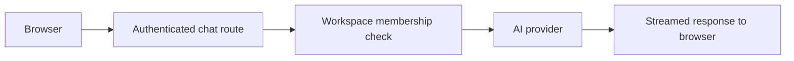

# Workspace AI Assistant

A private portfolio MVP demonstrating authenticated, workspace-isolated AI chat with streamed output. Chat messages live in browser memory and are never stored in PostgreSQL.

## Setup

Requirements: Node.js 20+, PostgreSQL. Copy `.env.example` to `.env.local`, set a local database URL, a random Better Auth secret, and two synthetic demo passwords. `OPENAI_API_KEY` is only needed for a manual live-provider smoke test; automated tests use a fake provider.

```sh
npm install
createdb workspace_ai
npm run db:migrate
npm run db:seed
npm run dev
```

Seed users are configured by `DEMO_USER_A_EMAIL`, `DEMO_USER_A_PASSWORD`, `DEMO_USER_B_EMAIL`, and `DEMO_USER_B_PASSWORD`. The seed is repeatable. Chat requests are limited to 64,000 bytes, 30 conversation messages, and 4,000 text characters per message (with up to 20 text parts per message).

## Quality checks

```sh
npm run typecheck
npm run lint
npm test
npm run test:e2e
npm run build
```

## Tenant isolation

The server reads identity from the Better Auth session and checks `(userId, workspaceId)` membership before looking up instructions or invoking the provider. The chat endpoint does not accept a user ID or authoritative system prompt from clients. Workspace access is enforced independently of model instructions.



Automated chat route tests inject session, membership, and provider adapters; UI streaming tests use a delayed fake stream. They require no AI key or database. Any database-backed authorization tests must use an isolated test database, never a development or production database.

## Two-minute demo

1. Sign in as User A and open Northstar Studio.
2. Send a short product-planning prompt and observe the response stream.
3. Stop a response and verify partial text remains.
4. Sign out, sign in as User B, and verify only Harbor Analytics is listed.
5. Attempt User A's workspace URL as User B and confirm access is denied.

## Features and limitations

Implemented: password sign-in for seeded accounts, membership-filtered workspace list, server-side membership checks, workspace-specific instructions, streamed chat, in-memory conversation state. Limitations: no persisted chat, public signup, invitations, admin, file uploads, RAG, tools, billing, model selection, or production-grade abuse protection. Keep the demo local/private until cost limits and abuse controls exist.

Agent-assisted development used the `implement-spec` skill; implementation was performed in the integration branch. A human must review and approve before merge. The live-provider smoke test is left to the owner.
