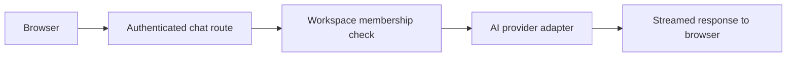

# Workspace AI Assistant

A private portfolio MVP demonstrating authenticated, workspace-isolated AI chat with streamed output. Chat messages live in browser memory and are never stored in PostgreSQL.

## Local setup

Requirements: Node.js 20+, PostgreSQL, and a local database named `workspace_ai`.

1. Copy `.env.example` to `.env.local`.
2. Set `DATABASE_URL`, a random `BETTER_AUTH_SECRET` with at least 32 characters, and distinct synthetic passwords for `DEMO_USER_A_PASSWORD` and `DEMO_USER_B_PASSWORD`. The example supplies demo email addresses.
3. Install dependencies and prepare the database:

   ```sh
   npm ci
   createdb workspace_ai
   npm run db:migrate
   npm run db:seed
   ```

4. Start the app with `npm run dev` and open <http://localhost:3000>.

The repeatable seed creates User A/Northstar Studio and User B/Harbor Analytics with separate workspace instructions. `OPENAI_API_KEY` is needed only for an owner-run live-provider smoke test. Never use production credentials in local or automated testing.

Each message is limited to 4,000 characters, each conversation request to 30 messages, and each HTTP request body to 64 KB. Requests over these limits are rejected before provider invocation.

## Quality checks

Run all gates from the repository root:

```sh
npm run typecheck
npm run lint
npm test
npm run test:e2e
npm run build
```

Unit and route tests use controlled streams and fake adapters, so they require no AI key or database. Vitest loads the local Next.js environment files. The authorization integration tests run when `TEST_DATABASE_URL` is set; it must point to a migrated database named exactly `workspace_ai_test`. They run the seed against that database, verify workspace membership and credential account IDs, and sign in both demo users through Better Auth. These tests write only to the dedicated test database, so never point `TEST_DATABASE_URL` at a development or production database you care about. The Playwright journey needs a disposable PostgreSQL database with the schema and demo seed applied, plus a Chromium browser installed (`npx playwright install chromium`). It logs in as User A, opens Northstar Studio, sends a message, and observes the streamed fake response. Configure the Playwright environment with `DATABASE_URL`, `BETTER_AUTH_SECRET`, both demo emails, and both demo passwords before starting `npm run test:e2e`. Use a dedicated test database; never point it at a development or production database you care about.

CI runs these checks on pull requests and pushes to `main`. Its PostgreSQL 16 service uses a fresh `workspace_ai_test` database. Demo passwords and the Better Auth secret in CI are synthetic job-local values. `CHAT_FAKE_PROVIDER=true` selects the deterministic, delayed fake stream only outside production, and CI supplies no AI key or production credentials.

## Tenant isolation and streaming

The server reads identity from the Better Auth session and checks `(userId, workspaceId)` membership before reading workspace instructions or invoking the provider. The chat endpoint accepts neither a user ID nor an authoritative system prompt from clients. Tests verify that anonymous and non-member requests do not reach the provider; browser and UI tests cover incremental streaming and workspace state isolation.



## Two-minute demo

1. Sign in as User A with the locally configured demo credentials.
2. Open Northstar Studio, send “Plan a short demo,” and watch the response arrive as a stream.
3. Start another response and select Stop; verify partial output remains and is marked stopped.
4. In a separate private browser session, sign in as User B and verify only Harbor Analytics appears.
5. Try opening `/w/workspace-a` in User B's session and confirm access is denied.

The committed [chat screenshot](output/playwright/critical-journey.png) shows the actual chat component with a deterministic streamed test response. The automated login-and-stream journey saves its own screenshot at the same path when run against a migrated, seeded test database. CI also uploads Playwright results as a workflow artifact.

## Implemented features and limitations

Implemented: seeded password sign-in, membership-filtered workspace list, server-side page and chat authorization, workspace-specific instructions, streamed chat, stop/retry controls, in-memory conversation state, fake-provider tests, and a Playwright login-and-stream journey.

Limitations: no persisted chat, public signup, invitations, membership administration, file uploads, RAG, tools/function calling, billing, model selection, or production-grade abuse protection. Keep the demo local or private until cost limits and abuse controls are added. The manual smoke test with a real provider is assigned to the owner and is not part of CI.

Agent-assisted implementation followed the `implement-spec` and `tdd` skills. The Playwright skill was consulted for browser-artifact conventions; the required automated test is implemented with the repository's installed `@playwright/test` convention. No claim is made that other skills or agents were used.

A human must review and approve before merge.
